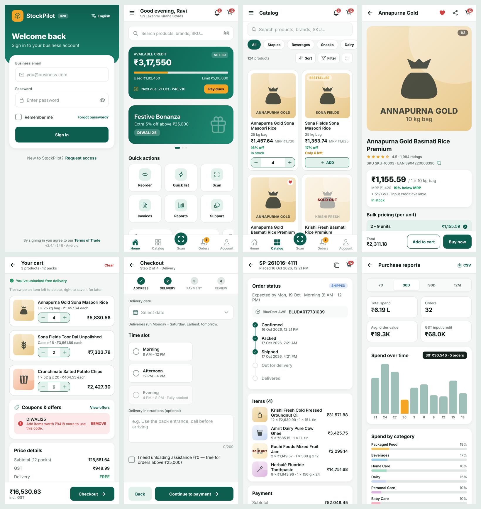
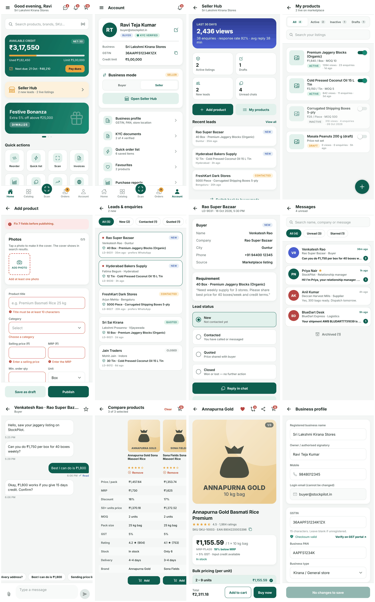

# StockPilot B2B — a realistic practice app for Appium & Mobilewright

StockPilot is a **B2B wholesale marketplace app** for kirana stores, supermarkets and the suppliers who sell to them. In **buyer mode** retailers browse a distributor catalogue, compare products, ask sellers for the best price, buy on a Net-30 credit line, track deliveries and download GST invoices. In **seller mode** the same user lists products, answers leads, sends quotations and chats with buyers. It looks and behaves like a production app, but every screen was designed to exercise a mobile-automation skill — and every element has a stable `testID`.

Built with **Expo SDK 58 / React Native 0.88 / Expo Router**, so the same code runs as a native Android and iOS app. **Version 2.5.0 (250).**

Most of the app runs against a built-in mock backend, so tests are repeatable. A few features call **real public APIs** (live exchange rates, India Post pincode lookup) and one screen is a **real in-app browser** — so you also get practice with the messiness of live data.

The Web portal includes a **Vortex QA** bookmark that opens https://vortex-qa.vercel.app in the app's WebView. StockPilot and Vortex use separate accounts and data; opening Vortex does not connect StockPilot's native screens to the Vortex API.



**New in 2.5.0 — seller mode, leads, inbox, compare, reviews, live data:**



```
stockpilot/
├── src/app/            38 screens (Expo Router — every file is a route / deep link)
├── src/components/     shared UI (header, cards, sheets, dialogs, steppers…)
├── src/data/           mock backend, 124-product catalogue, users, orders, seller listings, leads, chats, live-API client
├── src/state/          app state, cart maths, error handling
├── docs/LOCATORS.md    every test ID (850+), by screen
├── docs/EXERCISES.md   122 graded exercises + bug-hunt answer key
├── tests/mobilewright/ Mobilewright (Playwright-style) sample suite, Screen Object Model
└── tests/appium-wdio/  Appium + WebdriverIO (TypeScript) sample suite, Page Object Model
.github/workflows/build-apk.yml   builds the APK on GitHub for free
```

---

## 1. Get the APK

### Easiest — let GitHub build it (no Android Studio, no Expo account)
1. Create a new repository on GitHub (private is fine) and upload this folder to it, e.g.
   ```bash
   git init && git add . && git commit -m "StockPilot 2.5.0"
   git branch -M main
   git remote add origin https://github.com/<you>/stockpilot.git
   git push -u origin main
   ```
2. Open the repo → **Actions** tab → the **Build Android APK** run starts automatically (or press **Run workflow**). It takes about 15–20 minutes.
3. When it’s green, open the run → **Artifacts** → download **StockPilot-B2B-apk** → unzip → `StockPilot-B2B-v2.5.0.apk`.
4. `adb install -r StockPilot-B2B-v2.5.0.apk`

Push a tag (`git tag v2.5.0 && git push --tags`) and the APK is also attached to a GitHub Release. The APK contains `arm64-v8a` (real phones) and `x86_64` (emulators).

## 1b. Build it yourself

You need **Node 22+** and either Android Studio (SDK + an emulator, JDK 17) or Xcode (macOS).

```bash
npm install
```

### Option A — Android APK on your machine (recommended for Appium/Mobilewright)
```bash
npx expo prebuild -p android --clean
cd android && ./gradlew assembleRelease          # Windows: gradlew.bat assembleRelease
# APK → android/app/build/outputs/apk/release/app-release.apk
adb install -r android/app/build/outputs/apk/release/app-release.apk
```
The release build is signed with the debug keystore, so it installs on any emulator. It has **no Metro dependency** — ideal for automation.

### Option B — run straight onto a device/emulator
```bash
npx expo run:android        # or: npx expo run:ios   (macOS + Xcode)
```

### Option C — cloud build, no Android Studio (Expo account needed)
```bash
npx eas-cli@latest build -p android --profile apk        # downloadable .apk
npx eas-cli@latest build -p ios --profile simulator      # .app for the iOS simulator
```

> **Expo Go won’t work for automation** — the app uses native modules (camera, biometrics, notifications…) and your tests need the real package `com.stockpilot.b2b`.

| | Android | iOS |
|---|---|---|
| App id | `com.stockpilot.b2b` | `com.stockpilot.b2b` |
| Launch activity | `.MainActivity` | — |
| Deep-link scheme | `stockpilot://` | `stockpilot://` |
| WebView context | `WEBVIEW_com.stockpilot.b2b` | `WEBVIEW_<pid>` |

---

## 2. Test accounts

Password for every account: **`Pilot@123`**. OTP: read it from the SMS banner that slides in on the OTP screen (that’s part of the exercise), or turn on **QA Lab → Skip OTP**.

| Email | Behaviour |
|---|---|
| `buyer@stockpilot.in` | Happy path. Buyer, KYC verified, ₹5 L credit line |
| `approver@stockpilot.in` | Manager. Sees **Approvals**; can approve/reject orders > ₹50,000 |
| `slow@stockpilot.in` | Every API call takes 4–7 s extra — practise waits |
| `glitch@stockpilot.in` | Has **4 planted bugs** — find them (answer key in EXERCISES.md) |
| `newstore@stockpilot.in` | KYC pending — checkout blocked until 4 documents are uploaded |
| `locked@stockpilot.in` | Always fails with “account locked” |

Hidden shortcut: **long-press the StockPilot logo** on the login screen for 1.2 s → test-account picker.

## 3. QA Lab (developer options)

Unlock by tapping the version text on **Account** 7 times (like Android developer options), or open `stockpilot://qa-lab`.

| Control | Use it to practise |
|---|---|
| API latency 0–5,000 ms | Explicit waits, timeouts |
| Random server failures 0/10/30/50% | Retry logic, error states (`*-error`, `*-retry`) |
| Simulate offline | Offline banner, network error handling (the app *also* detects real airplane mode / Wi‑Fi off) |
| Promo pop-up Random / Always / Never | Handling unexpected interruptions |
| Screen transition animations | Flakiness vs. animations (also stops carousel auto-play) |
| Skip OTP | Fast login fixture |
| Expire session now | Session-expired native alert → back to login |
| Send push notification in 5 s | Notification shade, tapping a notification |
| Trigger JS crash | Crash screen + recovery |
| Reset app data | Clean state without reinstalling |
| Deep links list | One-tap deep links (also copyable) |

## 4. What’s inside (feature → automation skill)

| Feature in the app | Where | Skill |
|---|---|---|
| Onboarding pager, language chips (EN/हिन्दी/తెలుగు) | first launch | swipe, i18n-proof locators |
| Login validation, error banner, password eye, remember-me | Login | inputs, assertions, persistence across restarts |
| 6-box OTP with delayed SMS banner + 30 s resend timer | OTP | dynamic data, waits, regex |
| Side drawer + bottom tabs with badges | everywhere | navigation, badge counts, edge swipe |
| Credit card widget, auto-playing banner carousel, KPI scroller, live countdown | Home | horizontal scroll, timers, dynamic text |
| Random promo pop-up | Home | interruption handling |
| Debounced search, category chips, sort & filter sheets (slider, checkboxes, switches), grid/list toggle, infinite scroll, skeleton loaders, long-press quick actions | Catalog | lists, waits, sliders, long-press |
| Gallery with double-tap-to-like, full-screen **pinch-zoom** viewer, tier-pricing table, variant chips, MOQ-validated stepper, pincode checker, read-more, accordion | Product | gestures, state-based IDs |
| **Swipe-to-delete / swipe-to-save**, coupons, undo toast, GST maths | Cart | swipe, ephemeral toasts, calculations |
| 4-step checkout: address form (dropdown with search, **location permission**), **native date picker**, disabled radio, payment options, file picker, UPI countdown modal, “Leave checkout?” guard | Checkout | forms, system pickers, permissions, back-button |
| Status timeline, cancel with reason + native alert, reorder, **GST invoice share**, dispute with **camera/gallery** | Order details | alerts, share sheet, camera |
| Segmented tabs, date-range filter, pull-to-refresh that changes data | Orders | dynamic data |
| Camera barcode scanner with torch + EAN-13 checksum validation | Scan | camera permission |
| Swipe actions, filter chips, mark-all-read | Notifications | swipe |
| Chat with typing indicator & bot replies, attachments | Chat | keyboard, async messages |
| Bar chart with tap tooltips, nested horizontal table, **landscape**, CSV export | Reports | orientation, nested scroll |
| **Drag & drop** re-ordering | Quick order list | drag gestures |
| Upload with progress bar + size validation | KYC | file upload, progress waits |
| Cross-field validation (PAN ↔ GSTIN), unsaved-changes dialog | Business profile | complex forms |
| Theme, language, biometrics, **app lock PIN after background**, change password strength meter | Settings | background/foreground, biometrics |
| Terms (scroll-to-end gate), Help centre, Feedback form | WebView | **hybrid context switching** |
| Manager approvals with bulk select | Approvals | role-based flows |
| **Buyer ⇄ seller mode switch** (Account), mode-dependent drawer & home | Account / Drawer | role-based UI, conditional elements |
| Seller Hub KPIs, my products with status tabs & on/off switches | Seller Hub | dashboards, switches, filtered lists |
| Add/edit product: up to 5 photos (camera/gallery, upload progress, set cover), 80-char counter, price ≤ MRP rule, dynamic spec rows (max 6), draft vs publish, unsaved-changes dialog, delete alert | Seller → Add product | long forms, dynamic lists, limits, permissions |
| Leads with status filters, lead detail, quotation sheet with live total, **call (`tel:`) & WhatsApp intents** | Seller → Leads | state transitions, leaving the app |
| Messages inbox: search, unread/starred filters, **swipe to archive/star**, undo, long-press menu, archived section | Messages | swipe actions, long-press, undo toasts |
| Chat with **Sent → Delivered → Read ticks**, quick replies, per-contact bot replies | Chat | timed state changes, async waits |
| Compare up to 3 products, “best value” highlights | Catalog long-press / Product → Compare | tables, cross-element assertions |
| Rating breakdown bars, review list with sort, write-a-review form | Product | star taps, sorting, validation |
| “Get best price” enquiry → becomes a lead in Seller Hub | Product | two-sided flows |
| 🌐 **Live exchange rates** + 30-day bar chart + converter (Frankfurter API) | Drawer → Live market rates | real network waits, ranges instead of exact values, pull-to-refresh, error/retry |
| 🌐 **India Post pincode lookup** with post-office picker, offline fallback | Checkout address / Product pincode | live API, fallbacks |
| 🌐 GSTIN **checksum** validation + open the GST portal | Business profile | algorithmic validation |
| 🌐 **Web portal**: full in-app browser (address bar, progress, back/forward, bookmarks, errors) loading real websites | Drawer → Web portal | **WebView on live sites**, native ↔ web context switching |
| 🌐 Real connectivity detection | Everywhere | airplane mode, `toggleAirplaneMode` |

## 5. Deep links

```
stockpilot://home                     stockpilot://catalog?category=dairy
stockpilot://product/SKU-10001        stockpilot://cart
stockpilot://order/<ORDER_ID>         stockpilot://promo/DIWALI25
stockpilot://notifications            stockpilot://quick-list
stockpilot://reports                  stockpilot://settings
stockpilot://qa-lab                   stockpilot://webview?doc=feedback
stockpilot://messages                 stockpilot://chat?cid=C-buyer-1
stockpilot://seller                   stockpilot://seller/products
stockpilot://seller/product-form      stockpilot://seller/leads
stockpilot://seller/lead/LD-9031      stockpilot://compare
stockpilot://market                   stockpilot://browser
stockpilot://browser?url=https%3A%2F%2Fthe-internet.herokuapp.com%2Flogin
```
URL-encode a URL you pass inside a deep link (`encodeURIComponent` in JS).
```bash
adb shell am start -W -a android.intent.action.VIEW -d "stockpilot://product/SKU-10001" com.stockpilot.b2b
xcrun simctl openurl booted "stockpilot://product/SKU-10001"
```
Deep links need you to be logged in; otherwise you land on Login.

## 6. Locators in one minute

```ts
// Mobilewright (Android + iOS)
await screen.getByTestId('login-email-input').fill('buyer@stockpilot.in');

// Appium + WebdriverIO
$('id=login-email-input')     // Android (with appium:disableIdLocatorAutocompletion: true)
$('~login-email-input')       // iOS
```
Full list: **[docs/LOCATORS.md](docs/LOCATORS.md)**. Practice plan: **[docs/EXERCISES.md](docs/EXERCISES.md)**.

## 7. Run the sample suites

```bash
# Mobilewright
cd tests/mobilewright && npm install
npx mobilewright doctor
npx mobilewright test              # Android emulator must be booted & app installed
npx mobilewright show-report

# Appium + WebdriverIO
npm i -g appium && appium driver install uiautomator2      # (xcuitest for iOS)
cd tests/appium-wdio && npm install
APP=/path/to/StockPilot-B2B-v2.5.0.apk npm run android
```

## 8. Seed data you can rely on

- Catalogue is generated from a fixed seed → **the same 124 products, SKUs, EANs and prices on every install**. `SKU-10001` is always “Annapurna Gold Sona Masoori Rice 25 kg”.
- 13 seed orders across every status (Pending approval, Confirmed, Packed, Shipped, Out for delivery, Delivered, Cancelled, Rejected). Order IDs include the date, so they change daily — read them from the screen rather than hard-coding.
- Coupons: `B2B10` (10%, min ₹5,000), `DIWALI25` (5%, min ₹25,000), `FIRSTORDER` (15%, first order only).
- Seller data: listings `L-2001`…`L-2004` (active, active, inactive, draft); leads `LD-9031`, `LD-9030` (new), `LD-9027` (contacted), `LD-9021` (quoted), `LD-9012` (closed); conversations `C-rm`, `C-buyer-1`, `C-supplier-1`, `C-logistics`, plus archived `C-buyer-2`.
- Valid test GSTINs (checksum OK): `36AAPFS1234K1ZX`, `36AABCR9876M1ZI`, `37AAKFN4321R1ZP`. Change the last character to make one invalid.
- Business rules: min order ₹2,000 · free delivery ≥ ₹10,000 · approval needed > ₹50,000 · COD ≤ ₹50,000 · no Sunday deliveries · app-lock PIN `1234`.

Everything except the 🌐 features runs against a local mock backend — no server to set up. The 🌐 features need internet on the device; they use free public services (Frankfurter, India Post, the-internet.herokuapp.com, saucedemo.com) that don’t need keys but can be slow or down — write your tests to cope.
